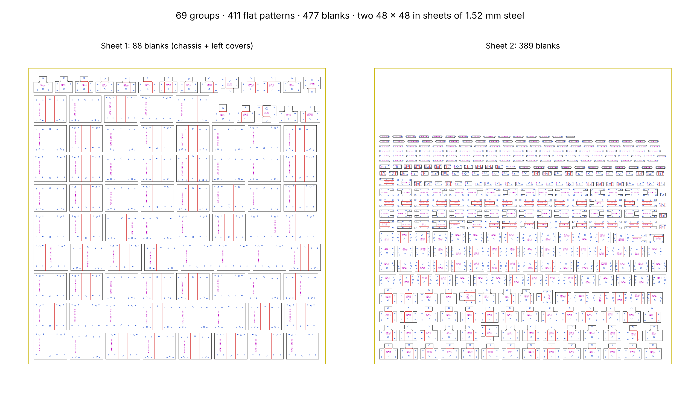
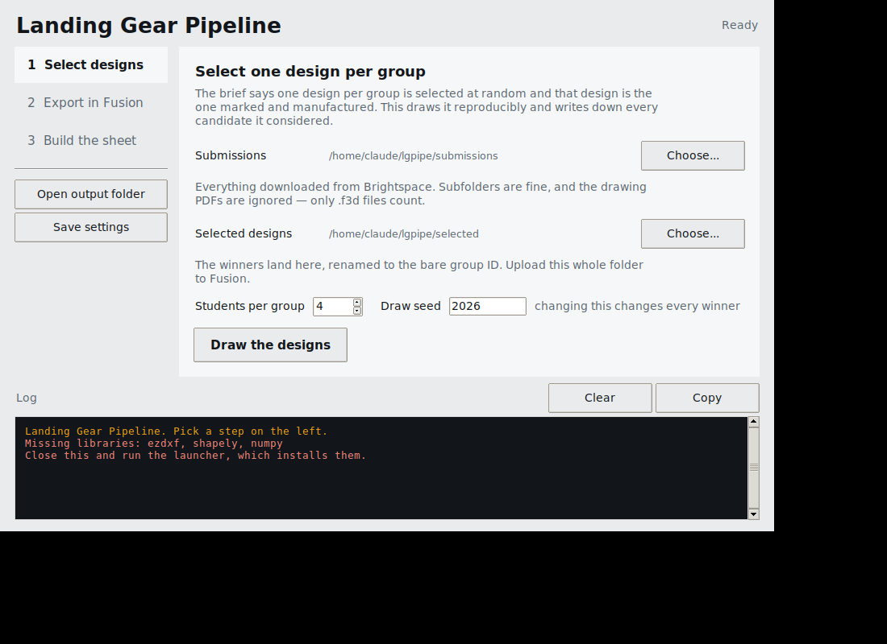
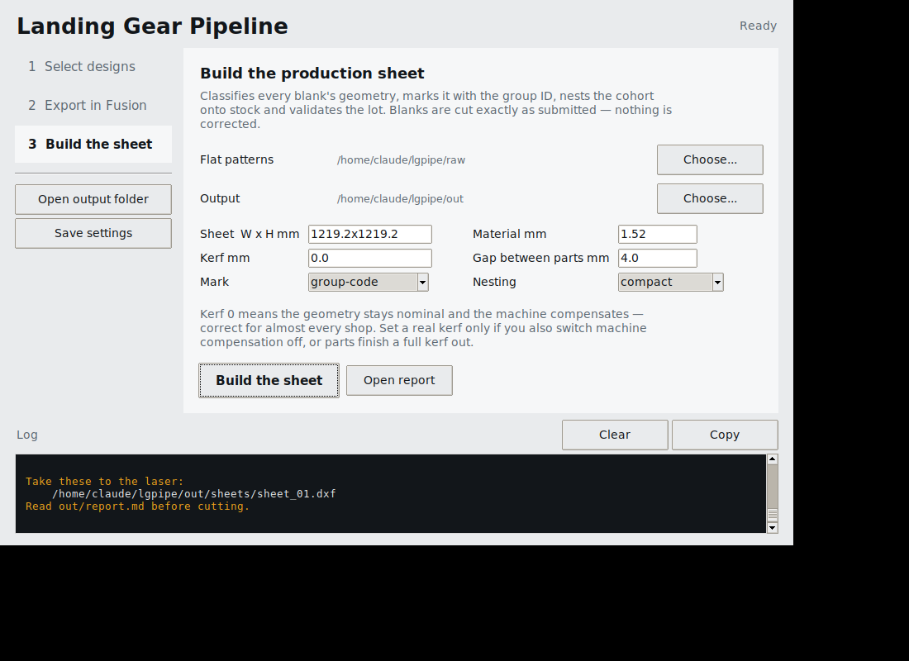
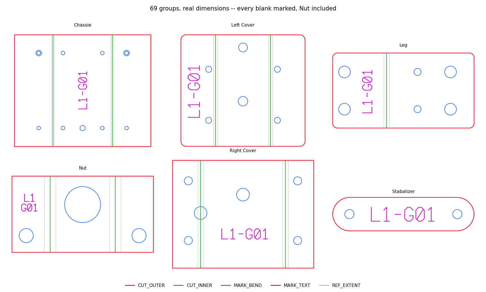
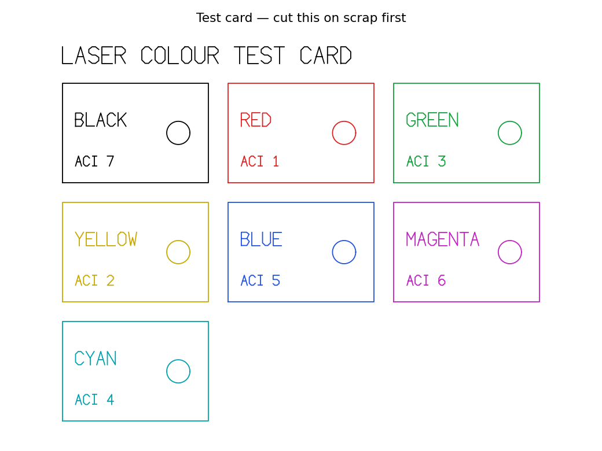

# Landing Gear Laser Pipeline

From ~240 student Fusion 360 submissions to laser-ready steel, in one pipeline.



Built for a second-year aerospace/mechanical engineering design course (Fall 2026), where every
group reverse-engineers a landing gear unit in Fusion 360, and one design per group is
manufactured from sheet metal, folded by the students and graded on the real part.

**This term:** 69 groups · 411 flat patterns · 477 laser-cut and laser-marked blanks ·
two 48 × 48 in sheets of 1.52 mm (16 ga) mild steel.

## The problem

Every student submits their own assembly. For each group, one design has to be chosen fairly, its
six sheet metal parts exported as flat patterns, checked, marked with the group's ID, nested onto
stock sheets, and sent to a CO₂ laser (Kern LaserCELL, CorelDRAW → KCAM). Doing that by hand for
~70 groups, inside a one-week manufacturing window, is days of error-prone work.

## How it works

```
Brightspace bulk download
        │
  1. Select designs      select_designs.py: one design per group, drawn at random
        │                with a fixed seed, backups recorded, every decision logged
  2. Export in Fusion    BatchExportProject: opens each design, exports every
        │                sheet metal flat pattern to DXF (.f3d and .f3z), logs issues
  3. Build the sheet     lgpipe: classifies geometry (outer cut, holes, bend lines),
        │                validates, laser-marks each blank with its group ID,
        │                nests onto stock sheets, writes cut-ready DXFs + a report
  4. Cut                 CorelDRAW → KCAM, colour-mapped layers
```

Everything runs from a small desktop window (`pipeline/app.py`) or the command line.

| | |
|---|---|
|  |  |
|  |  |

## What's in this repo

| Folder | What it does |
|---|---|
| `pipeline/` | The main tool: design draw, Fusion export scripts, geometry processing, marking, nesting, reports, GUI. See `pipeline/README.md` and `pipeline/SETUP.md`. |
| `pipeline/fusion/` | Fusion 360 scripts: batch flat-pattern export for a whole project, and single-design export. |
| `tools/group-recheck/` | Read-only Fusion check of every member's design when a group's drawn design fails, plus `MakeF3D` (turn a linked .f3z assembly into one self-contained .f3d). |
| `tools/submission-check/` | Pre-deadline submission audit: who submitted, missing files, possible copied designs. |
| `tools/vectorfill.py` | Converts filled (raster) ID marks into vector fill passes, an experiment for faster marking. |

## Highlights

- **Fair, reproducible draw.** Seeded per-group randomness, newest file per student, full backup
  order on record, so a failed design falls through to the next member without re-running the draw.
- **Geometry from topology, not layer names.** Closed loops become cuts (largest = outer profile,
  inside = holes), open chains become bend lines; tolerant of real-world Fusion exports.
- **Laser marking that fits.** A single-stroke font with a size ladder places the group ID in each
  part's largest clear area, with no student names on the steel, down to 1.6 mm text on the smallest part.
- **Nesting.** Corner-packed shelves with configurable part gap and sheet border; 477 blanks on 2 sheets.
- **Checks before cutting.** Watertight outlines, minimum hole size, extra loops, missing parts,
  off-roster groups, colour clashes; every blank is cut exactly as submitted.
- **Rehearsal mode.** `tests/rehearse.py` builds a full fake cohort with planted faults and runs the
  whole chain.

## Quick start

```bash
cd pipeline
pip install -r ../requirements.txt
cp roster.example.txt roster.txt        # your group IDs, one per line
python app.py                           # or: python -m lgpipe.cli --help
python tests/rehearse.py --run          # try it on a generated fake cohort
```

The Fusion scripts are installed through Fusion's **Utilities → Scripts and Add-Ins**. Full
instructions in `pipeline/SETUP.md` and `pipeline/2_UPLOAD_TO_FUSION.txt`.

## Lessons from the production run

- Students modelling parts as solids instead of sheet metal, and naming them freely, were the main
  failure modes. Strict, documented naming plus an automatic fallback to the next group member kept
  every group manufacturable.
- `.f3z` archives with linked parts need their links broken (in memory) before Fusion will flatten them.
- On a large flatbed, raster-engrave along the fast axis: rotating the layout 90° beats scanning in Y.
- Assist-gas consumption is driven by cutting time, not line count; measure it before committing a sheet.

## Privacy

No student data is included. Rosters, class lists, submissions, logs and reports are produced
locally at run time and excluded by `.gitignore`. The test fixtures use invented names.

## License

MIT, see `LICENSE`.
